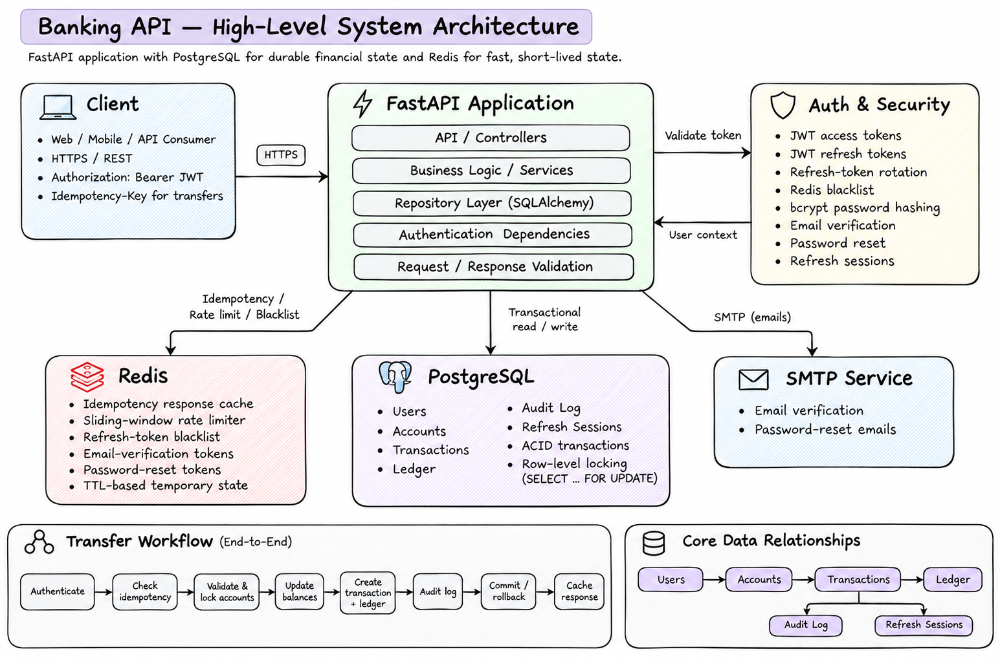

# 🏦 Banking API

A production-style banking backend built with **FastAPI, PostgreSQL, SQLAlchemy, and Redis**, focused on the engineering problems that make financial systems reliable rather than treating banking as a CRUD exercise.

> **Engineering focus:** financial correctness, concurrency control, idempotency, rate limiting, authentication, auditability, and failure-safe transaction processing.

## 🧭 Architecture



### Core transfer flow

```text
Client
  │
  │ POST /transactions
  │ Authorization + Idempotency-Key
  ▼
FastAPI API Layer
  │
  ├── Authenticate request
  ├── Check Redis idempotency record
  │      └── existing result → return cached response
  │
  ▼
Transaction Service
  │
  ├── Validate amount
  ├── Validate sender / receiver
  ├── Validate account state
  ├── Check sufficient balance
  ├── Reject self-transfer
  │
  ├── PostgreSQL row-level locking
  │      SELECT ... FOR UPDATE
  │
  ├── Debit sender
  ├── Credit receiver
  ├── Create transaction record
  ├── Create debit ledger entry
  ├── Create credit ledger entry
  ├── Create audit record
  │
  ├── COMMIT
  │
  └── Cache successful response in Redis
```

---

# ⭐ Engineering Highlights

The project is deliberately presented from the hardest engineering concerns down to the supporting backend functionality.

## 🔴 Advanced — Financial Correctness & Concurrency

### 1. Concurrency-Safe Fund Transfers

A bank account is shared mutable state. Concurrent requests must not be allowed to update the same balance using stale state.

The transfer workflow uses PostgreSQL row-level locks with:

```sql
SELECT ... FOR UPDATE
```

The sender and receiver account rows are selected in a deterministic order and locked before balance mutation.

**Goal:**

```text
Concurrent transfer requests
          ↓
PostgreSQL row locks
          ↓
Conflicting updates are serialized
          ↓
No stale balance update / double-spend
```

### 2. ACID Transaction Processing

A transfer is treated as one database transaction.

These operations are coordinated together:

```text
Sender balance update
        +
Receiver balance update
        +
Transaction record
        +
Debit ledger entry
        +
Credit ledger entry
        +
Audit record
```

The service explicitly commits the operation only after the workflow succeeds. Expected application failures and unexpected exceptions trigger a database rollback.

```text
Failure
   ↓
ROLLBACK
   ↓
No partially committed transfer state
```

### 3. Double-Entry Style Ledger

For a successful transfer, the system creates two ledger entries:

```text
Sender account   → DEBIT
Receiver account → CREDIT
```

The current balance answers **what the account contains now**; the ledger provides the transaction trail behind that state.

The repository also contains reconciliation logic intended to compare total debit and credit amounts.

### 4. Idempotent Transaction Processing

Transaction requests require an idempotency key.

```text
First request
    ↓
Process transfer
    ↓
Commit
    ↓
Store successful response in Redis

Retry with same key
    ↓
Redis lookup
    ↓
Return previously stored response
```

This protects the transaction endpoint from duplicate processing caused by client retries, timeouts, or repeated submissions using the same key.

---

# 🟠 Intermediate — Reliability & Security

## 5. Redis Sliding-Window Rate Limiting

The project implements a Redis-backed sliding-window limiter.

The rate-limit state contains:

```text
previous_count
current_count
window_start
```

The implementation uses Redis optimistic transactions:

```text
WATCH
  ↓
Read current state
  ↓
Calculate effective request count
  ↓
MULTI
  ↓
Write new state
  ↓
EXEC
```

The current implementation uses a **60-second window** and a configured request limit. It is applied to login requests and the repository also contains reusable user-scoped dependency support for endpoint rate limiting.

When the effective limit is exceeded:

```http
429 Too Many Requests
```

## 6. JWT Authentication

Implemented authentication features:

- JWT access tokens
- JWT refresh tokens
- explicit access/refresh token type validation
- token expiration
- protected endpoints through FastAPI dependencies
- bcrypt password hashing

### Access-token validation

The access token carries the authenticated user identifier and token type, and the backend verifies both the JWT signature and token type before loading the user.

## 7. Refresh-Token Sessions

Refresh tokens are persisted as database sessions containing:

```text
user_id
refresh_token
device_name
created_at
expires_at
```

The login flow also captures the request `User-Agent`, allowing the session to retain device information.

## 8. Refresh-Token Rotation

The refresh flow is:

```text
Verify JWT refresh token
        ↓
Check Redis blacklist
        ↓
Find stored refresh session
        ↓
Create new access token
        ↓
Create new refresh token
        ↓
Blacklist old token
        ↓
Replace stored session token
        ↓
Commit
```

## 9. Logout + Token Blacklisting

Logout performs:

```text
Verify refresh token
      ↓
Check whether token is already invalidated
      ↓
Blacklist token in Redis
      ↓
Delete refresh session from PostgreSQL
      ↓
Commit
```

Redis acts as a fast lookup layer for invalidated refresh tokens.

## 10. Email Verification

Registration supports email verification using short-lived Redis tokens:

```text
Register
  ↓
Generate verification token
  ↓
Store token in Redis with TTL
  ↓
Send verification email through SMTP
  ↓
User opens verification link
  ↓
Mark email as verified
  ↓
Delete token
```

The verification-token TTL is enforced by Redis.

## 11. Password Reset

Password recovery follows a similar short-lived-token workflow:

```text
Forgot password
      ↓
Generate reset token
      ↓
Store token in Redis
      ↓
Send reset link
      ↓
Validate token
      ↓
Hash new password
      ↓
Update PostgreSQL
      ↓
Delete reset token
```

---

# 🟡 Core Banking Functionality

## 12. User Management

Implemented capabilities include:

- user registration
- email validation
- email uniqueness checks
- phone-number uniqueness checks
- bcrypt password hashing
- email verification state
- lookup by user ID
- lookup by email
- lookup by phone
- password reset

## 13. Account Management

Authenticated users can create accounts.

The account model contains:

```text
Account ID
Account Number
Owner User ID
Account Type
Status
Balance
Created At
```

Account numbers are generated using a PostgreSQL sequence-backed identifier plus configured prefixes.

## 14. Transfer Validation Rules

Before modifying financial state, the transfer service validates:

- amount must be positive
- sender account must exist
- receiver account must exist
- sender account must not be frozen
- receiver account must not be frozen
- sender must have sufficient balance
- sender and receiver cannot be the same account

## 15. Transaction Records

Each transfer creates a transaction record containing:

```text
Transaction ID
Amount
Transaction Reference
Sender Account
Receiver Account
Status
Description
Created At
```

Transaction references are generated from a PostgreSQL sequence-backed identifier and application configuration.

## 16. Transaction History

Authenticated users can retrieve their transaction history with:

- transaction reference
- amount
- sender account number
- receiver account number
- transaction status
- description
- creation timestamp

## 17. Audit Logging

Financial operations create an audit record containing:

```text
User
Transaction
Action
Description
Timestamp
```

The audit record is created as part of the same database transaction as the transfer.

---

# 🟢 Backend Architecture

## Layered Architecture

```text
API / Controllers
       ↓
Service Layer
       ↓
Repository Layer
       ↓
PostgreSQL / Redis
```

### API / Controller Layer

Responsible for:

- HTTP routes
- request/response schemas
- dependency injection
- authentication dependencies
- rate-limit integration

### Service Layer

Responsible for:

- business rules
- authentication workflows
- fund-transfer orchestration
- commit / rollback boundaries
- coordinating database and Redis operations

### Repository Layer

Responsible for:

- database queries
- inserts and updates
- row locking
- Redis persistence
- refresh-session persistence
- audit persistence

---

# 🗄️ PostgreSQL Data Model

```text
users
  │
  ├────────► accounts
  │             │
  │             └────────► transactions
  │                              │
  │                              ├────────► ledger
  │                              └────────► audit_log
  │
  └────────► refresh_sessions
```

| Entity | Responsibility |
|---|---|
| `users` | Identity, credentials, verification state |
| `accounts` | Ownership, type, status, current balance |
| `transactions` | Transfer-level financial records |
| `ledger` | Debit / credit accounting entries |
| `Audit_log` | Financial activity traceability |
| `refresh_sessions` | Refresh-token session state |

---

# ⚡ Redis Responsibilities

Redis supports several independent pieces of application state:

| Redis capability | Purpose |
|---|---|
| Idempotency | Cache a successful transaction response by idempotency key |
| Rate limiting | Maintain sliding-window request state |
| Refresh blacklist | Reject invalidated refresh tokens quickly |
| Email verification | Store short-lived verification tokens |
| Password reset | Store short-lived password-reset tokens |

This keeps frequently accessed, short-lived state in Redis while PostgreSQL remains the primary source of persistent banking state.

---

# 🛡️ Failure Handling

### Expected business failure

```text
Validation / business-rule failure
              ↓
          db.rollback()
              ↓
          HTTP error
```

### Unexpected application failure

```text
Unexpected exception
        ↓
    db.rollback()
        ↓
   HTTP 500 response
        ↓
No partial financial state committed
```

This is particularly important for fund transfers because a transfer updates multiple related records.

---

# 🧪 Tests & Verification

The repository contains focused checks around the Redis and rate-limiting components, including:

- rate-limit behavior
- Redis optimistic transaction behavior using `WATCH`
- transaction-history test scaffolding

The Redis test demonstrates the conflict path where another client changes a watched key before `EXEC`, producing a Redis watch conflict.

---

# 🔌 API Surface

## Authentication

```http
POST /register
POST /login
POST /refresh
POST /logout
POST /forgot_password
GET  /verify-email
POST /reset-password
```

## Accounts

```http
POST /create_account
```

## Transactions

```http
POST /transactions
GET  /transactions_history
```

---

# 🧰 Tech Stack

### Backend
- Python
- FastAPI
- Uvicorn

### Database
- PostgreSQL
- SQLAlchemy

### State / Caching
- Redis

### Security
- JWT
- bcrypt password hashing

### Email
- SMTP

### Validation
- Pydantic

### Development
- Git
- GitHub

---

# 📁 Project Structure

```text
Banking-API/
│
├── app/
│   ├── api/
│   │   ├── AccountCreate.py
│   │   ├── Transactions.py
│   │   ├── User_login.py
│   │   └── User_register.py
│   │
│   ├── core/
│   │   ├── config.py
│   │   ├── redis_client.py
│   │   └── security.py
│   │
│   ├── db/
│   │
│   ├── dependencies/
│   │   └── rate_limit.py
│   │
│   ├── models/
│   │   ├── accounts.py
│   │   ├── audit.py
│   │   ├── ledger.py
│   │   ├── refresh_sessions.py
│   │   ├── transactions.py
│   │   └── user.py
│   │
│   ├── repositries/
│   │   ├── Transaction_repositries.py
│   │   ├── account_repositrie.py
│   │   ├── audit_repositry.py
│   │   ├── login_repositry.py
│   │   ├── redis_ratelimiter_service.py
│   │   ├── redis_repositries.py
│   │   └── user_repositries.py
│   │
│   ├── schemas/
│   │
│   ├── services/
│   │   ├── AccountCreation.py
│   │   ├── Transaction_services.py
│   │   ├── auth_services.py
│   │   ├── email_service.py
│   │   ├── hashing.py
│   │   ├── login_service.py
│   │   └── rate_limiter_service.py
│   │
│   └── tests/
│       ├── test_rate_limiter.py
│       ├── test_redis_transactions.py
│       └── test_transaction_history.py
│
└── requirements.txt
```

---

# ⚙️ Local Development

## 1. Clone

```bash
git clone https://github.com/GenZ-CODER-X/Banking-API.git
cd Banking-API
```

## 2. Create a virtual environment

```bash
python -m venv venv
source venv/bin/activate
```

Windows:

```powershell
venv\Scripts\activate
```

## 3. Install dependencies

```bash
pip install -r requirements.txt
```

## 4. Configure environment variables

Create a `.env` file matching the settings expected by `app/core/config.py`.

```env
DATABASE_URL=<postgresql-connection-string>
SECRET_KEY=<strong-secret>
ACCESS_TOKEN_EXPIRE_MINUTES=<minutes>
REFRESH_TOKEN_EXPIRE_MINUTES=<minutes>
ALGORITHM=<jwt-algorithm>

SECRET_PREFIX_STR=<prefix>
SECRET_PREFIX_INT=<integer>
SECRET_PREFIX_TRANSACTION=<transaction-prefix>

REDIS_HOST=localhost
REDIS_PORT=6379
REDIS_DB=0

SMTP_HOST=<smtp-host>
SMTP_PORT=<smtp-port>
SMTP_EMAIL=<sender-email>
SMTP_PASSWORD=<smtp-password>

BACKEND_URL=http://localhost:8000
```

## 5. Run the API

```bash
uvicorn app.main:app --reload
```

---

# 🔍 Why These Design Choices?

## Why row-level locking?

Because a balance is shared mutable state.

Without locking, two concurrent requests can read the same balance before either update becomes visible to the other request.

With row-level locking:

```text
Request A ──► lock account row ──► update ──► commit
Request B ──► waits for lock ─────► read latest state
```

The database therefore participates directly in maintaining financial consistency.

## Why idempotency?

Clients can retry after a timeout even when the original transaction succeeded.

The idempotency key lets the backend distinguish:

```text
New payment
```

from:

```text
Retry of an already processed request
```

## Why keep a ledger separate from balance?

The balance represents current state.

The ledger represents the accounting trail behind that state.

Together they provide both:

```text
Current balance
+
Historical financial activity
```

---

# 🚧 Roadmap — Toward Payment Infrastructure + Fraud Intelligence

The current repository is the banking core. The following are planned extensions and are **not claimed as implemented here**.

### Payment reliability
- exponential backoff and retry handling
- payment state machine
- provider failure recovery
- webhooks
- reconciliation

### Event-driven processing
- transaction events
- outbox pattern
- Kafka / event streaming
- asynchronous downstream consumers

### Fraud intelligence
- real-time fraud scoring
- behavioral and temporal features
- IP / device / session context
- ML-based transaction risk scoring
- rule + model decisioning

```text
Banking API
     ↓
Reliable Payment Infrastructure
     ↓
Event-Driven Payments
     ↓
Real-Time Fraud Intelligence
```

---

# 📌 Project Philosophy

This project treats banking primarily as a **correctness and reliability problem** rather than a collection of CRUD endpoints.

```text
Authentication
      +
Concurrency
      +
ACID Transactions
      +
Idempotency
      +
Rate Limiting
      +
Ledger Design
      +
Auditability
      +
Redis State Management
      +
Failure Handling
      =
Reliable Banking Backend
```

**Repository:** https://github.com/GenZ-CODER-X/Banking-API
